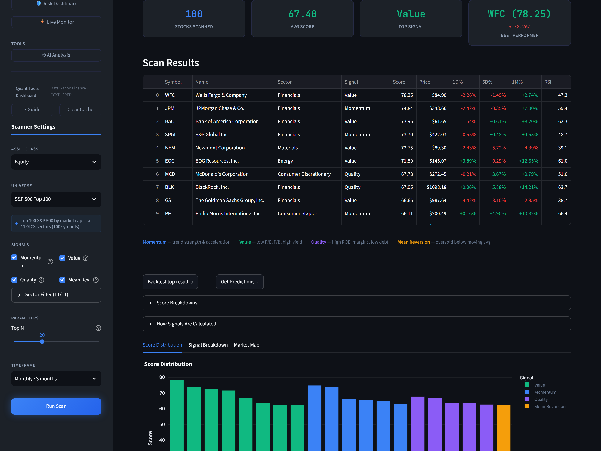
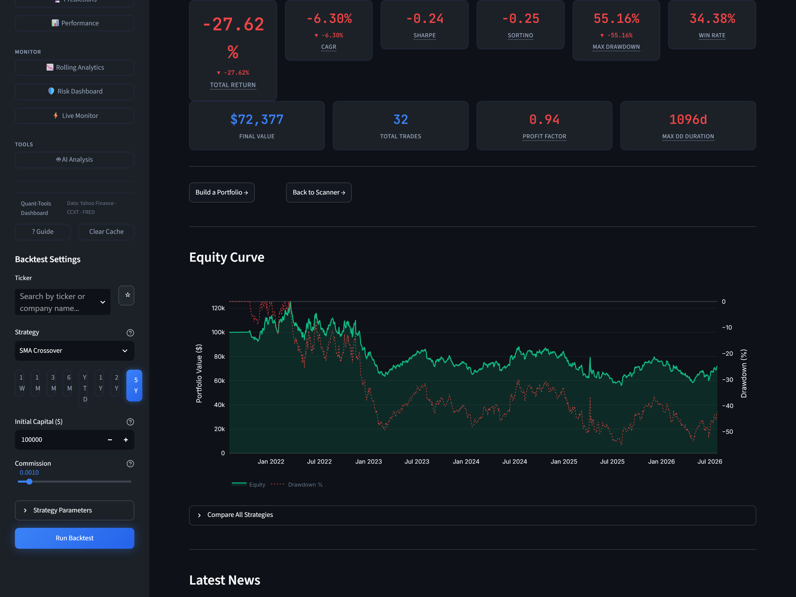
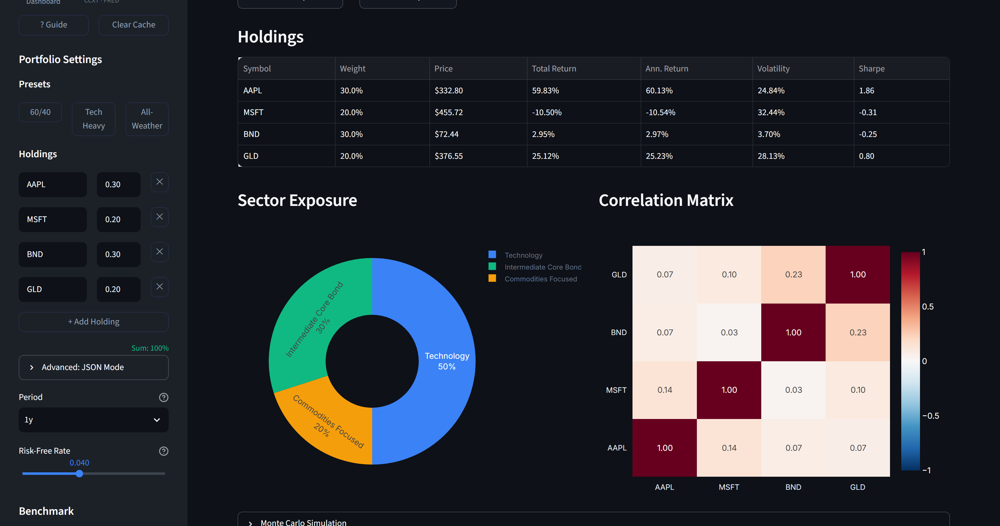
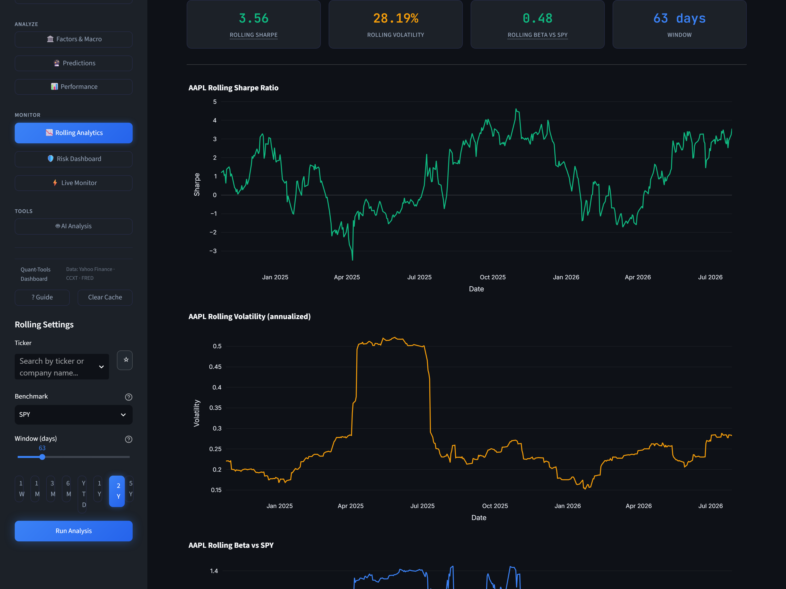

# quant-tools

Multi-asset quantitative finance toolkit for retail market analysis, backtesting, portfolio optimization, factor-based investing, and ML-powered predictions with win-rate tracking.

[](https://github.com/scaso01/quant-tools/actions/workflows/ci.yml)
[](https://www.python.org/downloads/)
[](LICENSE)

Equities, crypto, forex and commodities in one place. Every data source is free, so there is no API bill waiting for you at the end of the month.



## Quick Start

```bash
git clone https://github.com/scaso01/quant-tools.git
cd quant-tools
pip install -e ".[dev]"

# Optional: the ML prediction engine (Python 3.11 to 3.13, the torch-based
# dependencies do not support 3.14 yet). Everything else works without it.
pip install -e ".[ml]"

# Optional: API keys, all free, and only for the features that need them.
# The scanner, backtester and portfolio tools work with no keys at all.
cp .env.example .env

# Launch the dashboard
quant-tools web
```

That last command opens a ten page Streamlit app on `http://localhost:8501`. If you would rather stay in the terminal:

```bash
quant-tools scan --universe sp500 --top-n 20
quant-tools backtest --ticker AAPL --strategy sma_crossover --start 2020-01-01
quant-tools portfolio --holdings '{"AAPL":0.3,"BND":0.4,"GLD":0.3}'
```

## What You Get

### Backtest a strategy and see the drawdown, not just the equity curve



A vectorized numpy engine, so the run itself is not what you wait on. Seven years of daily bars backtest in under a millisecond once the prices are loaded, which means sweeping parameters is cheap. Results carry the metrics that decide whether a strategy is actually tradeable: Sharpe, max drawdown, win rate, profit factor, and a benchmark comparison against buy-and-hold.

### Analyze a portfolio, including the parts that hurt



Sector exposure, correlation heatmap, and a Monte Carlo fan chart that fits five distributions (Normal, Student-t, Skew-Normal, Johnson SU, GED) plus GARCH(1,1) and picks between them by BIC. Optimization runs through cvxpy for the convex problems (Markowitz, minimum variance) and scipy for risk parity.

### Watch a metric move through time



Rolling Sharpe, volatility and beta over a window you choose, so you can see when a strategy stopped working rather than reading one number for the whole period.

## Asset Classes

| Class | Provider | Source |
|-------|----------|--------|
| Equities | `EquityProvider` | yfinance, stooq |
| Crypto | `CryptoProvider` | CCXT |
| Forex | `ForexProvider` | yfinance, CCXT |
| Commodities | `CommodityProvider` | COT reports, ETF proxies |

Symbol auto-detection routes queries to the right provider. `BTC/USDT` hits crypto, `EUR/USD` hits forex, `AAPL` hits equities.

## Web Dashboard

`quant-tools web` starts a dark-themed Streamlit app with ten pages:

| Page | What it does |
|------|--------------|
| Market Scanner | Multi-asset scan across universe presets with per-signal breakdowns |
| Strategy Backtester | Equity curve with drawdown overlay, strategy comparison |
| Portfolio Analyzer | Sector donut, correlation heatmap, Monte Carlo fan chart, optimization, benchmark metrics |
| Factors & Macro | FRED regime detection, factor z-scores, rebalance recommendations |
| Predictions | Current forecasts, model agreement, confidence distribution |
| Performance | Win rate tracker, model comparison, confidence against accuracy |
| Rolling Analytics | Rolling Sharpe, volatility and beta against a benchmark |
| Risk Dashboard | VaR and CVaR, concentration, drawdown, correlation heatmap |
| Live Monitor | Watchlist quotes with price, change, volume and VWAP |
| AI Analysis | Natural language questions about a portfolio, via a local LLM |

The AI Analysis page needs an OpenAI-compatible server on `http://localhost:8080` (llama.cpp, Ollama and vLLM all work). Without one it says so and the other nine pages carry on.

## CLI Reference

All 28 commands, which is everything `quant-tools help` lists.

```bash
# Scanner
quant-tools scan [--universe sp500|sp100|russell1000|international|emerging|global]
                 [--sector Technology] [--top-n 20]
                 [--asset-class equity|crypto|forex|commodity|all]

# Backtesting
quant-tools backtest --ticker AAPL --strategy sma_crossover --start 2020-01-01

# Portfolio analysis
quant-tools portfolio --holdings '{"AAPL":0.3,"BND":0.4,"GLD":0.3}'

# Factor investing
quant-tools factors [--universe sp500] [--regime]

# ML predictions
quant-tools predict AAPL [--horizon 5] [--asset-class equity]
quant-tools predict BTC/USDT --asset-class crypto
quant-tools track [--symbol AAPL] [--model gradient_boost] [--limit 20]
quant-tools resolve                # Score pending predictions against outcomes
quant-tools clear                  # Delete stored predictions
quant-tools benchmark-models --symbols AAPL MSFT [--horizon 5]

# Risk
quant-tools risk --holdings '{"AAPL":0.5,"BND":0.5}' [--confidence 0.95]
quant-tools stress-test --holdings '{"AAPL":0.5,"BND":0.5}' [--scenario 2008_gfc]
quant-tools regime [--ticker SPY] [--period 5y] [--regimes 3]

# Data tools
quant-tools filings AAPL --type 10-K --count 5          # SEC EDGAR
quant-tools sentiment AAPL                              # Reddit sentiment    [keys]
quant-tools macro US --indicator gdp --range 2010:2025  # World Bank macro
quant-tools news 'AAPL earnings' [--days 30]            # GDELT              [alt-data]
quant-tools trends AAPL MSFT [--timeframe 'today 3-m']  # Google Trends      [alt-data]
quant-tools defi [--top 10] [--chain Ethereum]          # DeFi Llama yields
quant-tools defi --protocol aave                        # One protocol's TVL history
quant-tools fear-greed [--market crypto|equity]         # equity needs        [alt-data]
quant-tools options AAPL [--expiry 2026-01-16]          # Chain, put/call, max pain

# AI (needs an OpenAI-compatible server on localhost:8080)
quant-tools analyze AAPL [--depth quick|deep]
quant-tools ask 'What is my biggest risk' --holdings '{"AAPL":0.5,"BND":0.5}'

# Reporting and execution
quant-tools tearsheet --holdings '{"AAPL":0.5,"BND":0.5}' [--output tearsheet.html]
quant-tools paper-trade status|positions                 # Alpaca             [keys]
quant-tools paper-trade buy --symbol BTC-USD --qty 0.1 --provider crypto

# Interfaces
quant-tools web                    # Streamlit dashboard
quant-tools dashboard              # Terminal UI
quant-tools help                   # This list
```

`[alt-data]` marks commands needing `pip install -e ".[alt-data]"`. `[keys]` marks
commands needing credentials in `.env`; see `.env.example`. Everything else works
on a bare install.

### Universes

| Name | Symbols | Scan time | What it is |
|------|---------|-----------|------------|
| `sp500` | 518 | ~40s | The S&P 500 |
| `sp100` | 100 | ~9s | Its 100 largest by market cap, for a quick scan |
| `russell1000` | 922 | ~70s | The Russell 1000 |
| `international` | 49 | ~3s | Developed-market **ADRs**, Europe and Asia Pacific |
| `emerging` | 32 | ~3s | Emerging-market **ADRs** |
| `global` | 1002 | ~80s | Russell 1000 plus both ADR lists |

The two international lists are US-listed depositary receipts rather than index
constituents, so they are a liquid sample and not MSCI EAFE or MSCI EM coverage.
They are named ADRs for that reason.

Prices are fetched in bulk, a hundred symbols per request, so the largest
universes take roughly 70 to 80 seconds instead of the several minutes a
per-symbol fetch would cost. These lists are static snapshots, so a few names
have since been delisted; the scanner skips whatever the bulk request returns no
data for rather than retrying it.

## Optional Extras

| Extra | Install | Unlocks |
|-------|---------|---------|
| `ml` | `pip install -e ".[ml]"` | The prediction ensemble. Python 3.11 to 3.13 |
| `ml-neural` | `pip install -e ".[ml-neural]"` | TFT, PatchTST, N-HiTS, LSTM. See the note below |
| `alt-data` | `pip install -e ".[alt-data]"` | `news`, `trends`, `fear-greed --market equity` |
| `foundation` | `pip install -e ".[foundation]"` | Chronos and TimesFM forecasters |
| `realtime` | `pip install -e ".[realtime]"` | Alpaca paper trading |
| `reports` | `pip install -e ".[reports]"` | PDF output helpers |
| `nlp` | `pip install -e ".[nlp]"` | Transformer sentiment models |
| `docs` | `pip install -e ".[docs]"` | Docling PDF and DOCX parsing |
| `e2e` | `pip install -e ".[e2e]"` | Playwright browser tests |
| `dev` | `pip install -e ".[dev]"` | pytest and pyflakes |

`ml-neural` is separate from `ml` because its `neuralforecast` dependency needs
`ray`, and ray's newest release ships Windows wheels only through Python 3.12.
On Linux and macOS it goes to 3.14. Installed or not, the models report
themselves unavailable rather than failing the run.

Moirai is not in `foundation`: its `uni2ts` package pins numpy 1.26 while this
project needs numpy 2. The model stays in the tree and reports itself
unavailable, so nothing breaks, but there is no supported way to install it
alongside the rest.

## Prediction Engine

Needs the `[ml]` extra (`pip install -e ".[ml]"`, Python 3.11 to 3.13). With no ML packages installed, `quant-tools predict` raises a clear error rather than handing back a fake neutral forecast.

Twelve models feed a weighted ensemble vote. The core seven:

| Model | Type | Predicts |
|-------|------|----------|
| LightGBM | Gradient boosting | Direction and magnitude |
| AutoARIMA | Statistical | Trend |
| ETS | Exponential smoothing | Trend |
| LSTM | Neural network | Temporal patterns |
| N-BEATS | Neural network | Temporal patterns |
| Prophet | Additive model | Seasonality |
| GARCH | Volatility model | Volatility, used to adjust confidence |

TFT, PatchTST, N-HiTS and TimesNet need the separate `[ml-neural]` extra, and the `[foundation]` extra adds pretrained time-series models.

Everything validates walk-forward with `TimeSeriesSplit`. Ensemble weights adjust from tracked win rates, per model and per asset class, with a 5% floor so a cold streak cannot zero a model out. Predictions are stored in SQLite and scored against real outcomes later, which is what makes the win rate meaningful instead of decorative.

## Architecture

```
src/quant_tools/
├── data/
│   ├── providers/       # Unified data layer: base ABC, equity, crypto, forex, commodity, registry
│   ├── sentiment/       # Reddit sentiment via praw
│   ├── universes/       # Static JSON: S&P 500, Russell 1000, International
│   ├── futures.py       # 21 commodity products, calendar and volume roll, Panama back-adjustment
│   └── indicators_enhanced.py  # pandas-ta wrapper
├── predict/
│   ├── models/          # gradient_boost, stats_forecast, neural, prophet, garch
│   ├── features.py      # Feature engineering from OHLCV
│   ├── ensemble.py      # Weighted voting combiner
│   ├── tracker.py       # Prediction storage and retrieval (SQLite)
│   └── resolver.py      # Outcome resolution and weight updates
├── scanner/             # Concurrent multi-asset scanner and signal explanations
├── backtest/            # Vectorized numpy engine and benchmark metrics
├── portfolio/           # Monte Carlo, cvxpy optimizer, cross-correlation
├── factors/             # Factor scoring and macro regime detection
├── testing/             # Offline market data generator, used by CI
├── tui/                 # Textual terminal dashboard
└── dashboard/           # Streamlit web dashboard
```

## Docker

```bash
# Only needed for the macro regime page
export FRED_API_KEY=your_key

docker compose -f docker/docker-compose.yml up -d
# Dashboard on http://localhost:8503
```

Multi-stage Dockerfile, builder plus runtime. Or skip Docker: `quant-tools web` runs Streamlit directly.

## Testing

```bash
# Unit tests
python -m pytest tests/ --ignore=tests/e2e

# Browser tests, against a dashboard you start yourself
QUANT_TOOLS_OFFLINE=1 quant-tools web --server.port 8599 &
STREAMLIT_E2E_URL=http://localhost:8599 python -m pytest tests/e2e
```

Unit tests never touch the network: `tests/conftest.py` blocks requests, httpx, urllib, yfinance and fredapi outright.

The browser tests drive real Chromium against a real server, so those guards cannot reach it. `QUANT_TOOLS_OFFLINE=1` swaps the market data layer for a seeded generator instead, which keeps the run deterministic and offline. The dashboard shows a permanent banner whenever that flag is set, because fabricated prices should never be mistaken for real ones.

## Dependencies

No `ta-lib` and no `vectorbt`. Indicators are hand-rolled in numpy to avoid C-extension breakage on newer Python versions. The heavier pieces (`streamlit`, `plotly`, `ccxt`, `cvxpy`, `lightgbm`, `statsforecast`, `neuralforecast`, `prophet`, `arch`, `sec-edgar-downloader`, `praw`) are all free and unmetered.

## License

MIT. See [LICENSE](LICENSE).
